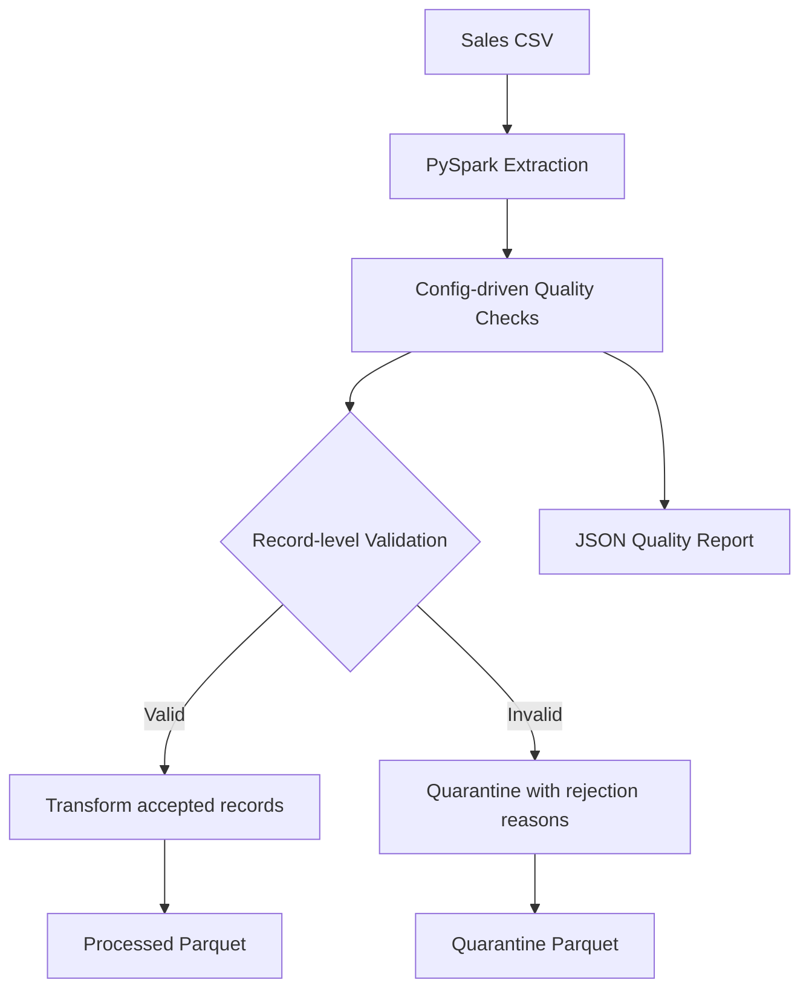

# PipeSage

**A PySpark ETL pipeline with configurable data-quality checks, invalid-record quarantine, and failure simulation.**

PipeSage demonstrates a practical data-engineering workflow: generate or ingest sales data, validate it against configurable rules, separate invalid records, transform accepted rows, and produce machine-readable quality reports.

> **Project status:** The PySpark ETL, validation, quarantine, and failure-simulation workflow is implemented. MCP server integration is a planned next milestone and is not yet included in the current codebase.

## Features

- **PySpark ETL:** Reads CSV sales data with an explicit schema, transforms accepted records, and writes Parquet output.
- **Config-driven validation:** Quality rules are maintained in `config/validation_rules.json`, separate from pipeline code.
- **Data-quality reporting:** Produces JSON reports with record counts, rule-level results, pass/fail status, and rejection rate.
- **Invalid-record quarantine:** Keeps accepted and rejected records separate. Rejected rows include a `rejection_reasons` array identifying the failed checks.
- **Failure simulation:** Generates datasets containing common data-quality issues for repeatable testing.
- **Input safeguards and logging:** Checks input paths and file formats and records pipeline execution details.
- **Automated tests:** Uses pytest to test validation, simulation, reporting, and pipeline behavior.

## Architecture



## Tech stack

- Python
- Apache Spark / PySpark
- Pandas
- pytest

## Project structure

```text
PipeSage/
├── config/
│   └── validation_rules.json
├── data/
│   ├── simulated/
│   └── processed_sales/
├── src/
│   ├── pipeline/
│   │   └── transform.py
│   └── simulator/
│       └── generate_data.py
├── tests/
├── requirements.txt
└── README.md
```

Generated datasets and pipeline outputs are runtime artifacts; they are not required to be committed to the repository.

## Getting started

### 1. Clone the repository

```bash
git clone https://github.com/rajdeep-senapati/PipeSage.git
cd PipeSage
```

### 2. Create and activate a virtual environment

Linux / macOS:

```bash
python3 -m venv .venv
source .venv/bin/activate
```

Windows PowerShell:

```powershell
py -m venv .venv
.venv\Scripts\Activate.ps1
```

### 3. Install dependencies

```bash
python -m pip install --upgrade pip
pip install -r requirements.txt
```

## Run the pipeline

Generate a clean sample dataset:

```bash
python -m src.simulator.generate_data --scenario clean
```

Run the ETL pipeline:

```bash
python -m src.pipeline.transform --scenario clean
```

The pipeline reads the generated CSV from `data/simulated/clean/sales.csv`.

### Simulate data-quality failures

The simulator supports these scenarios:

| Scenario | Injected issue |
|---|---|
| `clean` | No intentional validation issue |
| `null_customer` | Missing customer ID |
| `duplicate_order` | Duplicate order record |
| `zero_quantity` | Zero quantity |
| `negative_price` | Negative unit price |
| `invalid_date` | Invalid date value |
| `negative_quantity` | Negative quantity |

For example, to generate and process a dataset with a missing customer ID:

```bash
python -m src.simulator.generate_data --scenario null_customer
python -m src.pipeline.transform --scenario null_customer
```

### Custom input and output paths

The pipeline also accepts a custom CSV input and output directory:

```bash
python -m src.pipeline.transform --input path/to/sales.csv --output path/to/output
```

## Outputs

For a scenario named `null_customer`, the default output locations are:

| Artifact | Location |
|---|---|
| Accepted, transformed records | `data/processed_sales/null_customer/` |
| Quarantined records | `data/processed_sales/null_customer_quarantine/` |
| Quality report | `data/processed_sales/null_customer_quality_report.json` |

The accepted dataset is written in Parquet format. The quarantine dataset retains the original columns and adds `rejection_reasons`. The JSON report includes total, accepted, and rejected record counts, rejection rate, and per-rule validation results.

## Configure validation rules

Edit `config/validation_rules.json` to define checks for dataset columns.

Supported checks:

- `not_null`: rejects null values.
- `unique`: detects repeated non-null values.
- `positive`: rejects values less than or equal to zero.
- `non_negative`: rejects values below zero.

Example:

```json
{
  "rules": [
    {
      "column": "order_id",
      "checks": ["not_null", "unique"]
    },
    {
      "column": "quantity",
      "checks": ["not_null", "positive"]
    }
  ]
}
```

The configured rules are used for both quality evaluation and record quarantine.

## Run tests

```bash
python -m pytest -v
```

## Roadmap

- Add an MCP server that exposes the existing PipeSage engine as tools and resources.
- Add end-to-end MCP client integration and interaction examples.
- Expand integration coverage and operational observability.

## Why PipeSage?

PipeSage is a hands-on data-engineering project focused on reliable ingestion, explicit data-quality rules, explainable record rejection, and reproducible pipeline behavior. Its planned MCP layer will make these existing capabilities accessible to AI assistants through a standard tool interface.
