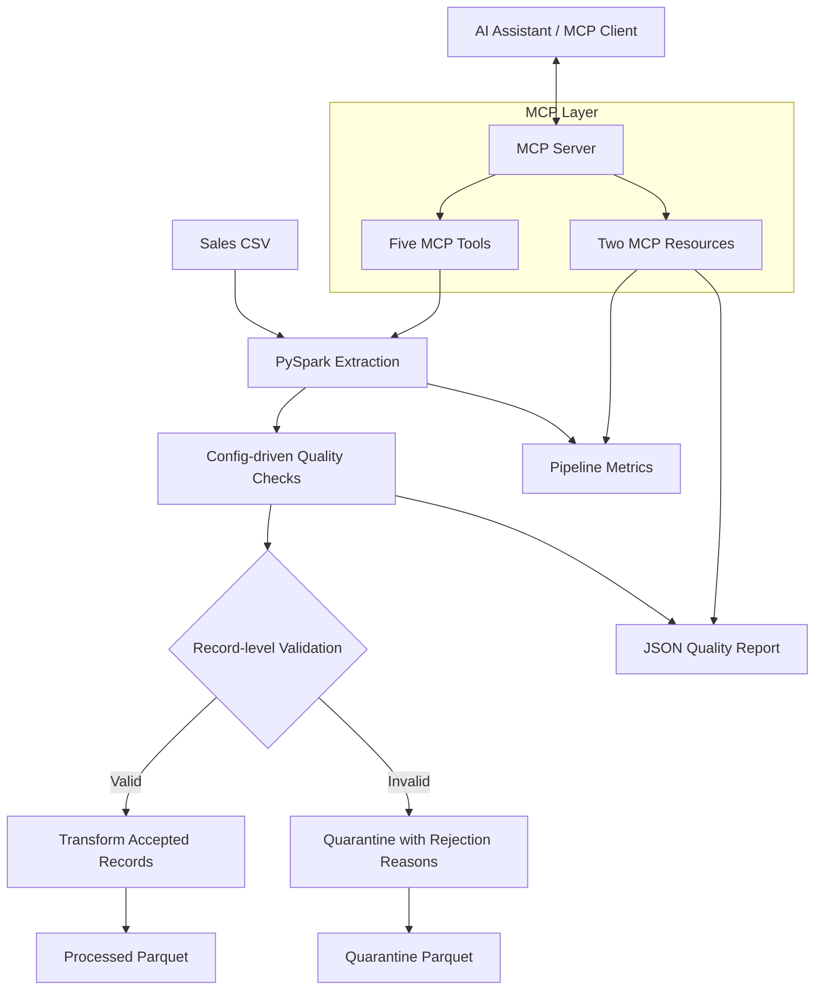

# PipeSage

**An MCP-enabled PySpark ETL and data-quality platform with configurable validation, invalid-record quarantine, pipeline observability, and AI assistant integration.**

PipeSage demonstrates a practical data-engineering workflow: ingest sales data, validate records against configurable rules, separate invalid records, transform accepted data, and generate machine-readable quality reports.

It also exposes pipeline capabilities through a **Model Context Protocol (MCP) server**, allowing AI assistants such as GitHub Copilot to execute pipelines, inspect validation results, and retrieve operational metrics through tools and resources.

## Features

- **PySpark ETL:** Reads CSV sales data using an explicit schema, transforms accepted records, and writes Parquet output.
- **Config-driven validation:** Quality rules are maintained in `config/validation_rules.json`, separately from pipeline logic.
- **Invalid-record quarantine:** Separates accepted and rejected records. Rejected rows include a `rejection_reasons` array identifying failed checks.
- **Data-quality reporting:** Generates JSON reports containing record counts, rule-level results, validation status, and rejection rates.
- **Pipeline observability:** Tracks execution duration and reports pipeline metrics.
- **Failure simulation:** Generates datasets containing common data-quality issues for repeatable testing.
- **MCP server integration:** Exposes pipeline operations through five MCP tools and two MCP resources.
- **AI assistant integration:** Enables MCP-compatible clients to execute pipeline operations and interpret data-quality results.
- **Automated testing:** Uses pytest for validation, pipeline, and MCP integration tests.

## Architecture



## Tech stack

- Python
- Apache Spark / PySpark
- Pandas
- Model Context Protocol (MCP)
- FastMCP
- Pydantic
- pytest

## Project structure

```text
PipeSage/
├── config/
│   └── validation_rules.json
├── data/
│   ├── simulated/
│   └── processed_sales/
├── src/
│   ├── pipeline/
│   │   └── transform.py
│   ├── simulator/
│   │   └── generate_data.py
│   └── mcp_server/
│       └── server.py
├── tests/
│   ├── test_validation.py
│   └── test_mcp_server.py
├── .vscode/
│   └── mcp.json
├── requirements.txt
└── README.md
```

Generated datasets and pipeline outputs are runtime artifacts and do not need to be committed to the repository.

## Getting started

### 1. Clone the repository

```bash
git clone https://github.com/rajdeep-senapati/PipeSage.git
cd PipeSage
```

### 2. Create and activate a virtual environment

Linux / macOS:

```bash
python3 -m venv .venv
source .venv/bin/activate
```

Windows PowerShell:

```powershell
py -m venv .venv
.venv\Scripts\Activate.ps1
```

### 3. Install dependencies

```bash
python -m pip install --upgrade pip
pip install -r requirements.txt
```

## Run the pipeline

Generate a clean sample dataset:

```bash
python -m src.simulator.generate_data --scenario clean
```

Run the ETL pipeline:

```bash
python -m src.pipeline.transform --scenario clean
```

The pipeline reads the generated CSV from:

```text
data/simulated/clean/sales.csv
```

### Simulate data-quality failures

The simulator supports the following scenarios:

| Scenario | Injected issue |
|---|---|
| `clean` | No intentional validation issue |
| `null_customer` | Missing customer ID |
| `duplicate_order` | Duplicate order record |
| `zero_quantity` | Zero quantity |
| `negative_price` | Negative unit price |
| `invalid_date` | Invalid date value |
| `negative_quantity` | Negative quantity |

For example:

```bash
python -m src.simulator.generate_data --scenario negative_price
python -m src.pipeline.transform --scenario negative_price
```

### Custom input and output paths

The pipeline also accepts custom CSV input and output paths:

```bash
python -m src.pipeline.transform --input path/to/sales.csv --output path/to/output
```

## MCP server integration

PipeSage exposes its data-engineering capabilities through an MCP server built with FastMCP.

Start the server:

```bash
python -m src.mcp_server.server
```

The server uses standard input/output (`stdio`) transport, allowing compatible MCP clients to communicate with it.

### Available MCP tools

| Tool | Description |
|---|---|
| `run_pipeline` | Executes the ETL pipeline for a selected scenario. |
| `validate_dataset` | Validates a CSV dataset against configured quality rules. |
| `get_quality_report` | Retrieves a saved data-quality report. |
| `get_pipeline_metrics` | Retrieves pipeline execution and quality metrics. |
| `list_failure_scenarios` | Lists the available failure-simulation scenarios. |

### Available MCP resources

| Resource URI | Description |
|---|---|
| `pipesage://validation-rules` | Exposes the configured validation rules. |
| `pipesage://quality-report/{scenario}` | Exposes a quality report for a selected scenario. |

### Example AI assistant interaction

An MCP-compatible assistant can be asked:

```text
Run the negative_price scenario using PipeSage.
Explain the pipeline status, accepted records, quarantined records,
and the validation rules that failed.
```

Example result:

```text
Pipeline status: completed_with_quarantine
Overall validation status: failed
Total records: 10
Accepted records: 9
Quarantined records: 1
Validation rules passed: 9
Validation rules failed: 1

Failed rule: unit_price.non_negative
```

This demonstrates how an AI assistant can invoke an actual data pipeline and interpret its returned quality results through MCP.

## Pipeline observability

Each pipeline execution generates operational and data-quality information, including:

- Total records processed
- Accepted and rejected records
- Rejection rate
- Passed and failed validation rules
- Overall validation status
- Pipeline execution status
- Execution duration in seconds

The `execution_duration_seconds` metric records pipeline execution through the output-writing and display stages, before Spark session shutdown.

## Outputs

For a scenario named `negative_price`, the default output locations are:

| Artifact | Location |
|---|---|
| Accepted, transformed records | `data/processed_sales/negative_price/` |
| Quarantined records | `data/processed_sales/negative_price_quarantine/` |
| Quality report | `data/processed_sales/negative_price_quality_report.json` |

The accepted dataset is written in Parquet format.

The quarantine dataset retains the original columns and adds `rejection_reasons`.

The JSON quality report includes record counts, rejection rate, validation results, pipeline status, and execution duration.

## Configure validation rules

Edit `config/validation_rules.json` to define checks for dataset columns.

Supported checks:

- `not_null`: Rejects null values.
- `unique`: Detects repeated non-null values.
- `positive`: Rejects values less than or equal to zero.
- `non_negative`: Rejects values below zero.

Example:

```json
{
  "rules": [
    {
      "column": "order_id",
      "checks": ["not_null", "unique"]
    },
    {
      "column": "quantity",
      "checks": ["not_null", "positive"]
    }
  ]
}
```

The configured rules are used for both quality evaluation and record quarantine.

## Run tests

Run the complete test suite:

```bash
python -m pytest -v
```

The project currently includes **34 automated tests**, covering pipeline validation and MCP integration.

## Why PipeSage?

PipeSage combines practical data engineering with AI interoperability.

It demonstrates how to build a data pipeline that does more than process records: it validates data, explains rejected records, tracks execution metrics, and exposes its capabilities to AI assistants through a standard tool interface.

By combining PySpark, configurable data-quality checks, observability, and MCP, PipeSage bridges traditional data engineering workflows with agentic AI applications.